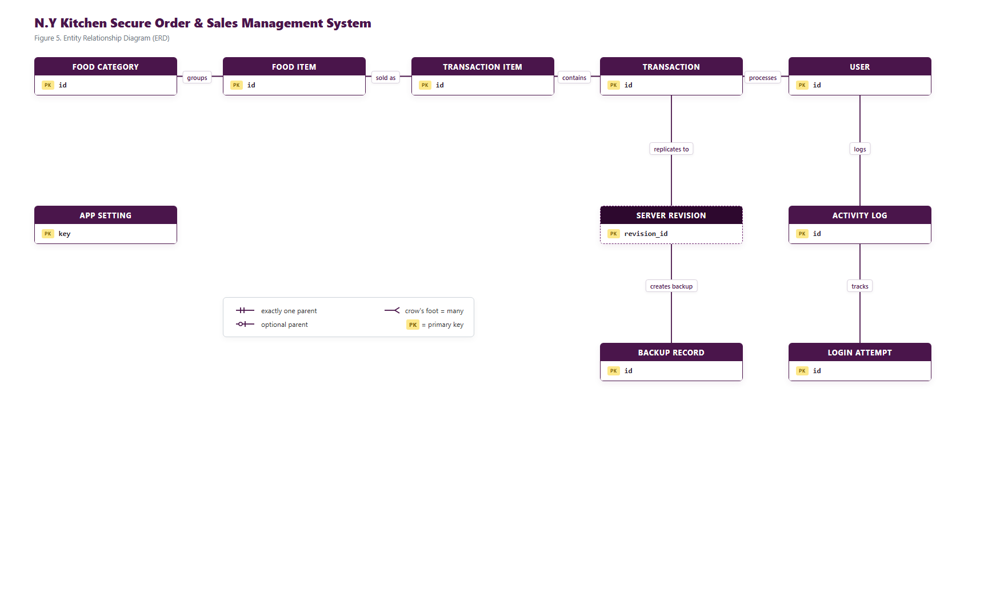
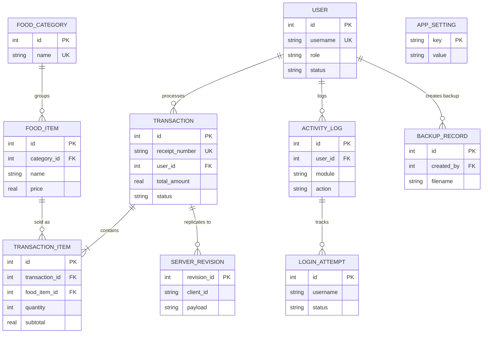
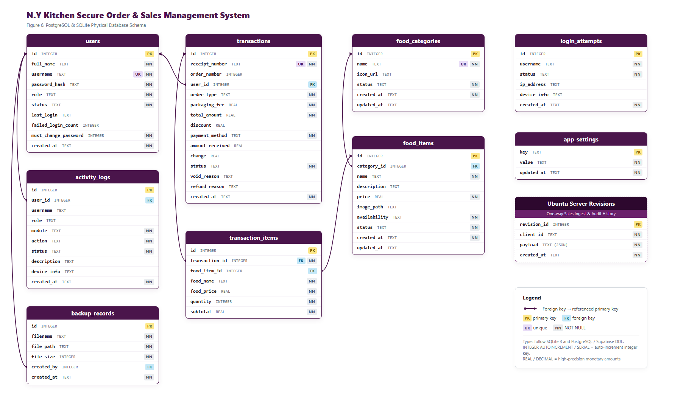

# N.Y Kitchen Secure Order & Sales Management System
## Database Schema, Entity Relationship Diagram (ERD) & Data Dictionary

---

### 4.4 Entity Relationship Diagram (ERD)

The conceptual ERD illustrates the core entities across menu management, point-of-sale transactions, user access control, audit logging, system configuration, and backend sales replication.

#### Mermaid Conceptual ERD

---

### 4.5 Physical Database Schema

The physical schema details table names, attribute names, data types, primary keys `[PK]`, foreign keys `[FK]`, unique constraints `[UK]`, and NOT NULL constraints `[NN]`.

---

### 4.6 Data Dictionary

The data dictionary below details the 9 local SQLite and Supabase synchronized entities, along with the Ubuntu server sales replication store.

#### Table 1. Users Data Dictionary (`users`)
| Field | Type / Constraints | Description |
|---|---|---|
| `id` | `INTEGER · PK AUTOINCREMENT` | Unique user account identifier |
| `full_name` | `TEXT · NN` | Full name of the staff member |
| `username` | `TEXT · UQ NN` | Unique username for authentication |
| `password_hash` | `TEXT · NN` | PBKDF2/SHA-256 salted password hash |
| `role` | `TEXT · NN` | Role designation (`admin` or `cashier`) |
| `status` | `TEXT · NN` | Account status (`active` or `disabled`) |
| `last_login` | `TEXT` | ISO 8601 timestamp of last successful authentication |
| `failed_login_count` | `INTEGER` | Consecutive failed attempts (triggers lockout after 5) |
| `must_change_password` | `INTEGER · NN` | Flag forcing password update on first login (0 or 1) |
| `created_at` | `TEXT · NN` | Account creation timestamp |

#### Table 2. Food Categories Data Dictionary (`food_categories`)
| Field | Type / Constraints | Description |
|---|---|---|
| `id` | `INTEGER · PK AUTOINCREMENT` | Category identifier |
| `name` | `TEXT · UQ NN` | Unique category name (e.g., Rice Meals, Pasta, Beverages) |
| `icon_url` | `TEXT` | Emoji or URL icon representation |
| `status` | `TEXT · NN` | Active status (`active` or `inactive`) |
| `created_at` | `TEXT · NN` | Record creation timestamp |
| `updated_at` | `TEXT` | Last modification timestamp |

#### Table 3. Food Items Data Dictionary (`food_items`)
| Field | Type / Constraints | Description |
|---|---|---|
| `id` | `INTEGER · PK AUTOINCREMENT` | Unique food product identifier |
| `category_id` | `INTEGER · FK` | References `food_categories.id` (ON DELETE SET NULL) |
| `name` | `TEXT · NN` | Display name of the food or beverage item |
| `description` | `TEXT` | Optional detailed description or ingredients |
| `price` | `REAL · NN` | Retail selling unit price in PHP |
| `image_path` | `TEXT` | Local file path or Supabase public storage URL |
| `availability` | `TEXT · NN` | Stock status (`available` or `out_of_stock`) |
| `status` | `TEXT · NN` | Item status (`active` or `archived`) |
| `created_at` | `TEXT · NN` | Record creation timestamp |
| `updated_at` | `TEXT` | Last update timestamp |

#### Table 4. Transactions Data Dictionary (`transactions`)
| Field | Type / Constraints | Description |
|---|---|---|
| `id` | `INTEGER · PK AUTOINCREMENT` | POS sale identifier |
| `receipt_number` | `TEXT · UQ NN` | Printable formatted receipt code (e.g., `NYK-20261030-001`) |
| `order_number` | `INTEGER` | Monotonic daily counter for kitchen order slips |
| `user_id` | `INTEGER · FK` | References `users.id` (cashier who tendered sale) |
| `order_type` | `TEXT · NN` | Dining arrangement (`dine_in` or `take_out`) |
| `packaging_fee` | `REAL · NN` | Additional fee applied for take-out packaging |
| `total_amount` | `REAL · NN` | Final transaction total payable |
| `discount` | `REAL` | Applied discount amount (e.g. Senior/PWD/promo) |
| `payment_method` | `TEXT · NN` | Tender method (`Cash`, `GCash`, `Maya`) |
| `amount_received` | `REAL` | Cash amount tendered by the customer |
| `change` | `REAL` | Change amount returned to customer |
| `status` | `TEXT · NN` | State (`completed`, `voided`, `refunded`) |
| `void_reason` | `TEXT` | Recorded justification if transaction was voided |
| `refund_reason` | `TEXT` | Recorded justification if transaction was refunded |
| `created_at` | `TEXT · NN` | Transaction completion timestamp |

#### Table 5. Transaction Items Data Dictionary (`transaction_items`)
| Field | Type / Constraints | Description |
|---|---|---|
| `id` | `INTEGER · PK AUTOINCREMENT` | Transaction line item identifier |
| `transaction_id` | `INTEGER · FK NN` | References `transactions.id` (ON DELETE CASCADE) |
| `food_item_id` | `INTEGER · FK` | References `food_items.id` (ON DELETE SET NULL) |
| `food_name` | `TEXT · NN` | Historical snapshot of item name at time of sale |
| `food_price` | `REAL · NN` | Historical snapshot of unit price at time of sale |
| `quantity` | `INTEGER · NN` | Number of units purchased |
| `subtotal` | `REAL · NN` | Line item total (`food_price * quantity`) |

#### Table 6. Activity Logs Data Dictionary (`activity_logs`)
| Field | Type / Constraints | Description |
|---|---|---|
| `id` | `INTEGER · PK AUTOINCREMENT` | Immutable audit log sequence ID |
| `user_id` | `INTEGER · FK` | Acting user ID (references `users.id`) |
| `username` | `TEXT` | Acting username captured at moment of event |
| `role` | `TEXT` | Acting user's role |
| `module` | `TEXT · NN` | Affected system domain (e.g., `Auth`, `POS`, `Menu`, `Backup`) |
| `action` | `TEXT · NN` | Action verb (`LOGIN`, `VOID_ORDER`, `EXPORT`, etc.) |
| `status` | `TEXT · NN` | Outcome (`SUCCESS`, `FAILURE`, `BLOCKED`) |
| `description` | `TEXT` | Detailed context or audit metadata |
| `device_info` | `TEXT` | Host OS, client machine name, or terminal metadata |
| `created_at` | `TEXT · NN` | Immutable audit entry timestamp |

#### Table 7. Login Attempts Data Dictionary (`login_attempts`)
| Field | Type / Constraints | Description |
|---|---|---|
| `id` | `INTEGER · PK AUTOINCREMENT` | Authentication attempt identifier |
| `username` | `TEXT · NN` | Submitted username attempt |
| `status` | `TEXT · NN` | Attempt outcome (`SUCCESS`, `FAILED_PASSWORD`, `LOCKED_OUT`) |
| `ip_address` | `TEXT` | Source IP address or loopback identifier |
| `device_info` | `TEXT` | Client platform and terminal information |
| `created_at` | `TEXT · NN` | Timestamp of login attempt |

#### Table 8. App Settings Data Dictionary (`app_settings`)
| Field | Type / Constraints | Description |
|---|---|---|
| `key` | `TEXT · PK` | Unique configuration key (e.g. `tax_rate`, `store_name`) |
| `value` | `TEXT · NN` | String or JSON serialized setting value |
| `updated_at` | `TEXT · NN` | Timestamp of last setting modification |

#### Table 9. Backup Records Data Dictionary (`backup_records`)
| Field | Type / Constraints | Description |
|---|---|---|
| `id` | `INTEGER · PK AUTOINCREMENT` | Backup record identifier |
| `filename` | `TEXT · NN` | Output encrypted/compressed archive filename |
| `file_path` | `TEXT · NN` | Local filesystem path to backup archive |
| `file_size` | `INTEGER · NN` | Archive size in bytes |
| `created_by` | `INTEGER · FK` | References `users.id` (administrator who created backup) |
| `created_at` | `TEXT · NN` | Timestamp of backup creation |

#### Table 10. Ubuntu Server Revisions Data Dictionary (`revisions` - Sync Subsystem)
| Field | Type / Constraints | Description |
|---|---|---|
| `revision_id` | `INTEGER · PK AUTOINCREMENT` | Ingest revision identifier on Ubuntu VM backend |
| `client_id` | `TEXT · NN` | Unique POS terminal device credential namespace |
| `payload` | `TEXT · NN` | Validated JSON payload of replicated sales |
| `created_at` | `TEXT · NN` | Timestamp of server ingestion |
