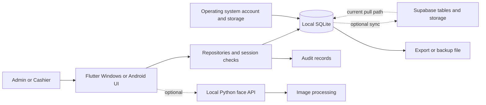

# Security implementation and defense plan

Updated October 20, 2026. Planning baseline, not a security certification.

## Rubric and assessment

Source: `C:/Users/tonton/Downloads/BSIT_Information_Assurance_Security_Framework_Rubric.xlsx`, worksheet `Security Rubric`. The workbook was read without modification. Its score cells are blank; summary zeroes are formula results for an unscored rubric, not a grade for this project.

There are 20 criteria, each worth 5 points. Rating choices are 5 (Fully Demonstrated), 4 (Acceptable), 3 (Needs Improvement), and 1 (Not Demonstrated). The six sections total 100 points. Readiness bands are 85–100 Security-Ready to Proceed, 75–84 Proceed Subject to Security Revision, and below 75 Not Yet Security-Ready. The rubric also lists critical requirements; a numerical score alone should not conceal missing scope, risk analysis, framework selection, or measurable testing.

The workbook evaluates security design and implementation readiness. For this nearly completed app, supply both design documents and actual verification. No numerical self-score is assigned yet. “Documented” and “implemented” are distinct from “verified.”

## Recommended deployment and tools

Keep the Windows Flutter application and SQLite as the primary demonstration environment. Android needs its own device verification if claimed as demonstrated. A separate server is unnecessary for core offline sales. The Python process is a local HTTP service only if face functionality is included; Supabase is the approved online synchronization boundary, confirmed by the owner on 2026-10-20. Connectivity is optional for core local operations; synchronization is part of project scope.

The owner clarified that Linux meant a virtual machine and can be omitted if unnecessary. No Linux VM, Kali, WSL, Docker, or new server is required by this rubric. No installation or host configuration change is part of this planning session.

| Tool | Recommendation and purpose | Limitation |
|---|---|---|
| Flutter tests and repository integration tests | Essential: exercise authorization, sessions, hashing migration, SQLite integrity, and offline flows | A test file's presence is not a passing execution |
| Windows PowerShell / curl.exe | Check the local API with missing, incorrect, and correct service keys; inspect listener binding | Do not put real keys in saved commands or screenshots |
| Python unittest/pytest and pip-audit | API behavior tests and Python dependency review | Pinning alone does not establish absence of vulnerabilities |
| Git review and a secret scanner such as Gitleaks | Inspect current files and history for leaked credentials | A leak requires rotation; ignoring the file does not undo exposure |
| OWASP ZAP desktop | Optional API testing against the disposable FastAPI instance, with OpenAPI import and recorded authenticated coverage | Does not test native Flutter widgets, local SQLite permissions, or business authorization by itself |
| Docker | Optional reproducible API/scanner lab after core fixes | Packaging does not provide application authorization; container localhost differs from Windows localhost |
| Linux VM / Kali / WSL | Omit from the initial defense setup | Adds setup and networking work without addressing the main observed weaknesses |
| DB Browser for SQLite or a read-only SQLite viewer | Optional inspection of a disposable demo database and evidence of stored hashes | Do not expose hashes, biometric templates, or real employee data during presentation |

Use a separate test database, synthetic accounts/orders, and a separate cloud test project if cloud behavior is included. A saved vulnerable snapshot can support a before/after demonstration. Do not weaken the current app to manufacture a vulnerability.

ZAP's API scan supports API descriptions and can actively send requests. On Windows, the desktop tool avoids a Docker networking detour. Import `/openapi.json`, configure the test service-key header, send valid multipart image requests, and verify the tested endpoint list. A report containing only 401 responses does not establish authenticated coverage. Inspect and triage alerts; a clean scan is not proof that the POS is secure.

## Security boundaries and assets

Trust boundaries: user input to application logic; application to local files; Flutter to Python HTTP service; local device to cloud; backup file to restore process. OS administrators, malware, or rooted devices can bypass application-only controls. Document that residual risk instead of describing SQLite logs as tamper-proof.

| Asset | Priority | Confidentiality | Integrity | Availability |
|---|---|---|---|---|
| Password hashes, service/device secrets, encryption keys | Critical | No display/export in ordinary reports; restrict storage and access | Only authenticated credential lifecycle may change them | Account recovery must remain possible |
| Sales, receipt items, monetary totals | Critical | Restrict business-wide reporting to Admin | Preserve completed records; validate totals and authorized state transitions | Offline checkout and recoverable backups |
| Account identity, roles, status | Critical | Minimize exposed employee details | Prevent self-promotion and unauthorized unlock/reset | Provisioned local login without cloud |
| Audit history | High | Admin access, own-event filtering where permitted | Reliable actor attribution; prevent application edits; assess file tampering | Available for investigation and recovery |
| Face templates/images, if enabled | High | Minimize collection; protect keys; avoid unnecessary cloud copies | Reject corrupt templates; protect enrollment | Password fallback and documented recovery |
| Menu, device, source and dependencies | High | Restrict privileged configuration | Authorized menu edits and trusted releases | Stable known build for defense |
| Backup/export files | Critical | Treat as containing sensitive database data | Authenticate and validate before restore | Restore rehearsal and protected rollback copy |

## Framework selection

- **Android:** OWASP MASVS control groups for storage, cryptography, authentication, network communication, platform interaction, code, resilience, and privacy. Select applicable controls and attach device evidence; do not claim full MASVS compliance.
- **Python API:** OWASP ASVS and API Security guidance for authentication, validation, resource limits, errors, and secrets. Top 10 material helps categorize weaknesses; it is not the acceptance test suite.
- **Windows and cloud operations:** NIST CSF 2.0 functions (Govern, Identify, Protect, Detect, Respond, Recover), with selected applicable endpoint/cloud configuration checks.
- **Threat analysis:** STRIDE categories organize spoofing, tampering, repudiation, disclosure, denial of service, and privilege elevation across the boundaries above.
- **Quality evaluation:** connect measured confidentiality, integrity, accountability, authenticity, reliability, and recovery outcomes to ISO/IEC 25010. Log entries alone do not prove strong non-repudiation or certification.

These are proposed applicable control families. During implementation, record the exact framework version and control identifier used for each test; avoid claiming an entire standard from this limited mapping.

## Rubric traceability

All rows are **Not scored**. Evidence listed below is required work, not a claimed result. IDs R01–R20 are local tracking IDs preserving the workbook order.

| ID | Exact criterion | Max | Required evidence / work |
|---|---|---:|---|
| R01 | Security scope and system boundaries | 5 | Boundary diagram above; final Windows/Android/cloud/face scope |
| R02 | Information assets and critical components | 5 | Asset table with owners, locations, and priorities |
| R03 | Confidentiality, integrity, and availability requirements | 5 | Asset CIA requirements; AT02, AT05, AT07, AT08 |
| R04 | Threat identification based on applicable security framework | 5 | STRIDE scenarios and boundary mapping in risk table |
| R05 | Vulnerability and weakness analysis | 5 | SEC findings with source location, reproduction, and framework basis |
| R06 | Risk assessment and prioritization | 5 | Likelihood/impact definitions, initial scores, residual scores after retest |
| R07 | Project-type security framework alignment | 5 | MASVS for Android, ASVS/API for service, NIST for operations; versioned controls |
| R08 | Identity, authentication, authorization, and access control | 5 | Role matrix and AT01–AT03, AT09 |
| R09 | Data protection, secrets, and secure communication | 5 | Hash/key/storage decisions, secret rotation evidence, AT04, AT06, AT10 |
| R10 | Secure architecture, network, cloud, and device protection | 5 | Binding/firewall/configuration review; cloud RLS negative tests; AT07, AT09, AT10 |
| R11 | Application / API / mobile / device security controls | 5 | Input, upload, storage and platform test results; AT02, AT04, AT09 |
| R12 | Security controls mapped to identified risks | 5 | Risk-to-control-to-test mapping below, with residual risk decisions |
| R13 | Framework-based security testing and verification plan | 5 | AT01–AT10 and applicable versioned framework control references |
| R14 | Security acceptance criteria and measurable results | 5 | Expected vs actual outcome and dated artifacts for each AT |
| R15 | Reliability, logging, monitoring, and auditability | 5 | AT03, AT05, AT07, AT08; denied-action and audit-failure handling |
| R16 | ISO/IEC 25010 security and framework compliance | 5 | Measured quality mapping; clearly bounded framework coverage |
| R17 | Privacy, data handling, and applicable compliance requirements | 5 | Data inventory, notice, lawful purpose/basis review, access/retention/deletion procedure |
| R18 | Backup, recovery, incident response, and continuity | 5 | Successful restore and corruption rejection; incident exercise; AT08 |
| R19 | Security documentation and control traceability | 5 | R-ID → risk ID → change → AT-ID → evidence → status |
| R20 | Overall security readiness of the capstone | 5 | Remaining risk review, critical checklist, independently reviewable scored rubric |
| Total | Six rubric sections: 15 + 20 + 25 + 20 + 10 + 10 | 100 | No earned score assigned |

## Risk register and treatment order

Provisional assessment: likelihood 1 = requires unusual privileged access, 2 = plausible with specific access/configuration, 3 = reachable in normal operation or easy for an insider. Impact 1 = minor disruption, 2 = limited disclosure/correctable records, 3 = sensitive disclosure, privilege escalation, or lost/altered sales. Score = likelihood × impact: 1–2 Low, 3–4 Medium, 6 High, 9 Critical. These are project planning ratings, not CVSS scores.

| Risk | STRIDE / finding | L × I | Reason | Prevent / detect / correct | Acceptance tests |
|---|---|---|---|---|---|
| K01 | Privilege elevation; SEC-01 | 3×3=9 | Inspected mutation methods lack acting-session permission checks; UI exploitability still needs reproduction | Central permission checks, denied-action logging, rollback/authorized correction | AT02, AT05 |
| K02 | Tampering; SEC-02 | 2×3=6 | Cloud configuration and writable data are prerequisites; current pull replaces local rows | Restrict sync scope and RLS, immutable record policy, conflict logging, reconciled recovery | AT05, AT10 |
| K03 | Disclosure/data loss; SEC-03 | 2×3=6 | Exported database data can be copied; restore path not established | Protected authenticated backup, actor logging, validated restore with rollback | AT08 |
| K04 | Spoofing/disclosure; SEC-04/05 | 2×3=6 | Copied hashes/templates enable offline analysis; local key access matters | Versioned password KDF and authenticated template encryption, migration checks | AT04, AT06 |
| K05 | Denial of service; SEC-08 | 2×3=6 | Configured cloud/startup failure may disrupt local operation | Initialize local DB first, isolate cloud failures, bound network waits, offline recovery | AT07 |
| K06 | Repudiation; SEC-11 | 3×2=6 | Rejected paths and caller-supplied identity leave audit gaps | Authoritative actor, complete security events, protected review/export, failure handling | AT03, AT05 |
| K07 | Disclosure/resource exhaustion; SEC-06/10 | 2×2=4 | Local API access/configuration required; upload processing is unbounded in inspected source | Safe errors, input/size limits, request throttling, failure logging | AT09 |
| K08 | Spoofing/configuration failure; SEC-07/09 | 2×3=6 | Default setup and service key propagation need verification | Forced setup, consistent config, credential rotation and secret scan | AT01, AT09, AT10 |

Residual scores stay unassigned until controls are tested. Highest priority: K01, K02, K03 and K05. Source findings are already recorded in `../SECURITY_DEFENSE_RECORD.md`; do not duplicate sensitive details in screenshots.

## Implementation sequence

### Stage 1 — Establish the demo boundary and authorization

Use Windows and a disposable SQLite database as the base. Record whether Android, cloud, and facial login are actually demonstrated. Keep cloud disconnected in the isolated baseline until its write policy is tested; this is a proposed demo configuration, not a change made in this session.

Implement a shared authorization policy that derives actor identity from the active session and rechecks account status for sensitive operations. Apply it to user creation/update/unlock/reset, menu changes, all-user queries, report/export, backup/restore, void/refund, and own-history access. Enforce allowed field lists and transaction state transitions. Do not trust `role`, `userId`, or `adminName` passed by UI callers as proof of authority. Prevent guarded children from rendering before access is granted.

Exit: AT01–AT03 and relevant AT05 cases pass; direct repository calls cannot bypass UI restrictions.

### Stage 2 — Protect records, credentials, and offline operation

Validate monetary inputs and compute trusted totals from persisted menu data and allowed discount rules; write related records atomically. Define whether failed audit writes abort sensitive mutations or enter a durable retry workflow.

Introduce versioned password hashes with per-record KDF parameters and successful-login migration. Benchmark the chosen work factor on Windows and Android; moving from 10,000 to a higher iteration count without compatibility handling would lock out existing accounts. OWASP currently lists 600,000 iterations for PBKDF2-HMAC-SHA256; record benchmark and migration evidence.

If face functionality remains in scope, replace fixed-IV CBC with authenticated encryption using a new random nonce per encryption, a versioned payload, secure key management, and explicit failure rejection. Verify how backups restore encrypted data on another device. Decide whether face templates need cloud synchronization at all.

Initialize local SQLite before synchronization, catch optional-cloud startup errors, add bounded timeouts, and verify offline startup/login/checkout. Remove raw exceptions from user-facing errors.

Exit: AT04–AT07 pass on selected target devices.

### Stage 3 — Recovery, cloud, and API

Implement an actual consistent SQLite backup/restore workflow. Authenticate backup contents, validate schema and integrity in a temporary location, pause DB writes/sync during replacement, retain a rollback copy, reopen and validate, then log the genuine actor. SQL inserts formatted for MySQL are not evidence of SQLite recovery.

For the approved cloud synchronization, select allowlisted fields, keep authorization/secrets local unless a reviewed provisioning design requires otherwise, preserve immutable sales/audit records, and test RLS with missing/wrong device credentials. Record actual policy export and deployment evidence. Avoid treating a client-held shared secret as equivalent to per-user cloud authorization.

For API inclusion, unify service-key configuration, verify loopback binding, validate image inputs and sizes, bound processing/rate, return safe errors, and check expected status codes. ZAP supplements these tests after valid API requests work.

Exit: AT08–AT10 pass for included features; excluded features have explicit scope and residual-risk notes.

### Stage 4 — Evidence and rehearsal

Capture reproducible before/after evidence, update the rubric table with measured results, complete privacy and incident procedures, and rehearse the demo offline. Freeze the rehearsed build and record its commit plus uncommitted changes. Do not upgrade dependencies or restructure the UI immediately before presenting without rerunning affected checks.

Suggested sequence for the stated Thursday defense: October 20 scope and critical controls; October 21 verification, recovery, evidence, and rehearsal; October 22 use the rehearsed build. If controls remain incomplete, disclose the limitations and narrow the demonstrated scope rather than claim a pass.

## Measurable acceptance and evidence

All tests below are **Planned / Not run in this session**.

| ID | Procedure and expected result | Evidence |
|---|---|---|
| AT01 | Synthetic account: five consecutive wrong passwords lock it; correct password while locked is denied; authorized unlock works; forced-change account cannot enter protected operations | Test output and sanitized UI sequence |
| AT02 | Call privileged repository methods as unauthenticated, Cashier, expired, disabled, and forged-actor callers; every prohibited request is rejected with zero protected mutations. Cashier own-record access succeeds; another cashier's records are denied | Integration tests checking database before/after and audit |
| AT03 | Advance a test clock beyond 30 minutes; protected operations fail. Log unknown, wrong-password, locked and successful attempts, logout and denial without passwords/hashes/templates. Admin review identifies actor/time/action/outcome | Timer tests, audit excerpt, UI rehearsal |
| AT04 | Same password produces different salted hashes; correct verification succeeds and incorrect fails; legacy hashes migrate only after successful login; policy rejects invalid passwords via direct repository call | Unit/migration tests and device timings |
| AT05 | Inject invalid totals/state transitions and forbidden void/refund; no unauthorized change. Successful sale saves header/items consistently. Audit insertion failure follows documented policy. Completed sales and audit entries resist app-level modification | Transaction and failure-injection tests |
| AT06 | Encrypt identical template twice: different ciphertext; bit-tampered, truncated, or wrong-key payload is rejected; legacy conversion and cross-device recovery behavior documented | Crypto/migration tests with synthetic data |
| AT07 | Disable network before launch with cloud configuration present; local login, menu, checkout, receipt and audit remain usable. Restart preserves sale. Repeat during network loss mid-session | Video plus database/test output; measured startup/checkout time |
| AT08 | Backup known fixture, change working copy, restore into disposable destination; row counts, sales totals and relationships match. Corrupt/wrong-key backup is rejected and original data remains usable | Restore transcript; proposed RPO ≤24h and RTO ≤15min measured in rehearsal, pending owner acceptance |
| AT09 | API: missing/wrong key →401; valid key and valid sample →expected success; malformed and oversized samples rejected by documented 4xx responses; errors omit internal paths. Verify loopback listener and bounded request behavior | API tests, listener evidence, optional triaged ZAP report |
| AT10 | Review source/history and rotate any exposed secrets. Against own cloud test project, unauthorized reads/writes fail, password hashes/secrets are absent from payloads, prohibited immutable overwrites fail, and conflicts are handled | Redacted scanner results, policy export, negative tests; no live production scan |

Store new evidence under `docs/security/evidence/2026-10-defense/` when it exists. Each result records R-ID, K-ID, AT-ID, framework/version/control, build revision, platform, setup, expected/actual result, date, reviewer, and evidence path. Keep historical evidence in its original location.

## Privacy, incidents, and continuity

For Philippine deployment, review the Data Privacy Act with the institution/client for the actual processing arrangement. Maintain a data inventory with purpose, access, recipient, storage, retention and disposal for employee identity, logs, sales and biometrics. The law's principles include transparency, legitimate purpose and proportionality; this plan does not establish legal compliance.

Use synthetic data for the defense. Before enabling face collection, define the lawful basis/notice and whether consent is required, offer the established password path, minimize retained raw images, and document deletion and template/key recovery. Set retention with the client/institution rather than inventing a statutory duration. Preserve required financial records while minimizing unnecessary personal data.

Incident exercise: identify unexpected Admin action → preserve logs/build details → disable affected account and isolate optional sync → rotate affected credentials → assess record changes → recover from validated backup → document impact and prevention → notify the responsible client/institution contact and follow applicable notification requirements. Do not promise a notification deadline without determining the applicable incident facts and policy.

Continuity: keep a protected backup outside the working device, rehearse restore, retain a known build, and define temporary manual order recording during device failure with controlled later reconciliation.

## Ten-minute defense demonstration

1. **0:00–1:00:** State scope, assets and trust boundaries; explain why SQLite supports availability.
2. **1:00–2:00:** Explain one concrete risk and its framework/control/test mapping.
3. **2:00–4:00:** Show Cashier sale, denied Admin operation, and corresponding automated direct-call test.
4. **4:00–5:00:** Demonstrate lockout and sanitized audit record using a disposable account.
5. **5:00–6:00:** Disconnect network; complete and persist a sale.
6. **6:00–7:30:** Show before/after evidence for a reproduced weakness, such as missing repository authorization. Explain prerequisites and the fix. If not reproduced, label it a source finding.
7. **7:30–8:30:** Demonstrate verified backup restoration or a clearly labeled recording from the same build.
8. **8:30–10:00:** Present rubric coverage, measured results, unresolved risks, and the incident procedure. Add API/ZAP evidence only when that service is in scope.

Keep short recordings/screenshots ready in case hardware/network fails. Do not label recordings as a live test. Avoid showing account hashes, keys or biometric data. Be ready to explain that Windows administrator access can bypass app-only file protections, and that a scanner cannot validate all business rules.

## Official references reviewed

- [OWASP MASVS](https://mas.owasp.org/MASVS/) — mobile control groups.
- [OWASP ASVS](https://owasp.org/projects/asvs) — application verification requirements.
- [NIST CSF 2.0 overview](https://www.nist.gov/news-events/news/2024/02/nist-releases-version-20-landmark-cybersecurity-framework) — governance and operational functions.
- [OWASP password storage](https://cheatsheetseries.owasp.org/cheatsheets/Password_Storage_Cheat_Sheet.html) — password KDF guidance.
- [ZAP API scanning](https://www.zaproxy.org/docs/docker/api-scan/) and [API import/testing](https://www.zaproxy.org/faq/how-can-you-use-zap-to-scan-apis/) — API-specific coverage.
- [Microsoft WSL](https://learn.microsoft.com/en-us/windows/wsl/install) — optional Linux environment on Windows.
- [ISO/IEC 25010:2023](https://committee.iso.org/standard/78176.html) — quality model reference; no certification claimed.
- [Philippine Data Privacy Act](https://privacy.gov.ph/Data-Privacy-Act/) — privacy principles and data handling basis.

## Implemented addition — 2026-10-22

The owner chose Flutter plus an Ubuntu VM backend. VM installation is pending. `../backend/README.md` documents the new one-way sales synchronization mode, strict API permissions, deployment and limitations. Local test evidence (11 backend + 4 Flutter passes) is in `security/evidence/2026-10-defense/backend_verification.md`. The earlier local-permission, backup and full acceptance plans remain open. The face API is a separate component; the new sync API provides an additional HTTP security demonstration target.
